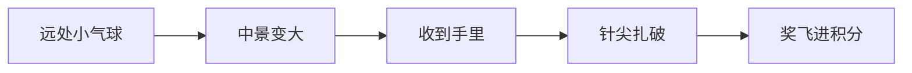

# 气球拉针 · 正式版策划

> **玩法一句话**：柚柚站在地上攥着一根风筝线，线的另一头消失在天上，上面串着无限的气球。按住抓取键把整串从远处收到手里，最近那只贴到地面上的针就爆，立刻拿到这只气球里的奖。松开即停，停住的不爆。  
> **工程**：Godot 4.7 · 街机小游戏合集 · 键位与 `BoardLink` 一致。  
> **本步**：只定正式版怎么玩、怎么看。不改 `scripts/balloon_game.gd`，不改转盘目录。示意版代码先留着，下一轮按本文改表现。  
> **旧稿**：`docs/气球拉针_Agent策划简报.md` 是第一稿。奖品种类和拉绳手感以本文为准。

针不动，气球动。人也不跟着线跑。线从远处收到她手里。

---

## 1. 和示意版的差别

示意版里气球一样大，沿一根垂直绳子往下掉。正式版绳子像风筝线：一头攥在柚柚手里，另一头消失在天上。拉的时候整串沿这条线靠近。近的气球大，在屏幕上走得快；远的气球小，几乎不动。针仍然钉在地上，只有贴到针尖的那一只会爆。

---

## 2. 画面

| 项 | 约定 |
|----|------|
| 人 | 画面左下，脚踩现在这张暖色地面。待机、拉绳两帧继续用，不重画 |
| 绳子近端 | 锁在她拳头上。两帧拳头位置不同，绳子跟着走 |
| 绳子远端 | 收到天空偏上的一个消失点。线可以略弯，像有一点风，不要画成尺子 |
| 粗细和大小 | 绳子近处粗、远处细。最近一只气球大约示意版那么大，最远一只大约四分之一。同一时刻大约看得见 6 只 |
| 针 | 针尖放在绳子到达拳头之前的那个点上，扎最近那只的底部。针不动 |
| 贴图 | 现有红、黄、蓝、绿气球、筹码、彩票、金币、碎片接着用。远处只是把同一张图缩小 |

示意版出现过「人手里一根短绳，天上另一根线」的断开。正式版不允许。线的近端必须进拳头。

远处不新画远景气球，也不做真 3D。深度用位置和缩放做出来：沿一条略弯的线，从拳头插到消失点，越远越小、越细。

---

## 3. 怎么拉

- **按住抓取键**（PC 上空格、按住鼠标同样）是一顿一顿地收线，不是匀速下滑。每顿整条线靠近一截：近处气球在屏幕上跳一大步，远处只挪一点点。
- **松开**立刻停。停住的气球不爆，也不退回远处。松手时线可以松弛一下，只是看起来垂一点，气球的前后顺序和深度不变。
- **不按得越快线越快。** 按住也只是按固定节奏重复收线，真机抓取键能按住。
- **不能跳过。** 远处那只再值钱，也要先扎破前面的。
- **没有失败。** 拉 **30 秒** + 结算约 **5 秒**。一直拉满，大约扎破 **16** 只，期望积分约 **12**（`ArcadeGameCatalog.TARGET_AVG_SCORE`）。
- 摇杆不用。返回大厅仍是现有 **15 秒**自动返回。

公共 API 不变：`start_round`、`stop_and_hide`、`on_board_key`、`round_finished`、`ask_return_hub`。

---

## 4. 奖

不再用旧简报里的「小奖 1 / 中奖 3 / 大奖 8」。一只气球里的奖在它生成时就定了。

| 种类 | 权重 | 分数 | 外观 |
|------|------|------|------|
| 空球 | 约 54% | 0 | 红气球。只爆，不飞数字 |
| 积分 | 约 30% | 1 | 黄气球。爆开飞出好几枚筹码 |
| 彩票 | 约 12% | 2 | 蓝气球。飞出好几张票 |
| 游戏币 | 约 4% | 5 | 绿气球，每一层深度都比别的球更大、更亮。一只里最多一枚金币 |

奖要在球靠近、变得够大时才看得清。远处只靠颜色，以及金币球的个头，知道后面有什么。隔着三四只也能认出后面有一枚币。这是这局里唯一的期待：看见币就继续拉，前面的空球也得先扎掉。

正式拉速和权重做出手感后再改，上表是锚点，不是锁死的像素。

---

## 5. 建议一起做的手感

这些是发挥。觉得多余就砍，不影响上面的循环。

- 不拉的时候线轻轻晃，气球小幅点头。深度不动，所以不会自己碰到针。
- 爆只有近处那只。碎片按它当时的大小散开。空球不飞数字。
- 金币球从远处就被看见，是这一局的期待感，不做额外的大奖 UI。

声：收线一声轻绳响，爆开一声，金币再叠一层亮音。大厅 BGM 先复用，不新做一首。

---

## 6. 这版仍然不做

- 炸弹、扣分、连扎加分。加分会把期望抬过 12。
- 移动的针、第二根针、道具。
- 新角色、真 3D、为远处另画一套气球。
- 不恢复已经移出工程的旧游戏。
- 转盘先不收这款。PC 测试按钮留着，给下一轮改表现时看效果。
