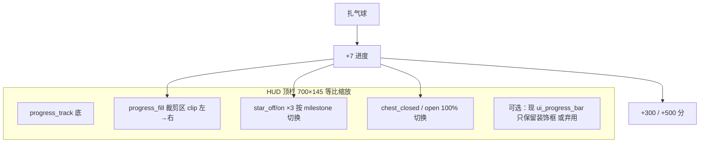

# 气球拉针 · 进度条充能（即梦拆分策划）

> **现状**：`assets/balloon/ui_progress_bar.png` 整图做框，程序用 **黄色 ColorRect** 在轨内从左往右拉长表示充能；里程碑 **25% / 50% / 75% / 100%** 对应 **+300 / +300 / +300 / +500** 分（`balloon_game.gd`）。  
> **目标**：即梦出**可拆分**的充能美术——**能量条随扎气球变长**；**三颗星按进度逐个亮起**；**100% 时宝箱从关到开**。  
> **进游戏前**：只出 `assets/balloon/designs/progress/` 预览；你说「进游戏」再写入 `assets/balloon/` 并改 HUD 叠层逻辑。

---

## 1. 为什么要拆，不整张重画一张

现在一张里 **星永远是亮的、箱永远是关好的样子 + 左侧一点黄**，和程序进度对不上。要做：

| 表现 | 需要的美术 |
|------|------------|
| 0%～24% | 暗星 ×3，箱关闭，轨内无/少量能量 |
| 到达 25% | 第 1 颗星 **灭→亮**（可闪一下） |
| 50% / 75% | 第 2 / 3 颗依次亮 |
| 100% | 能量满轨，第 3 星已亮，**宝箱播放「打开」**（静态开盖图或 2～4 帧） |

所以至少要有：**轨底框、能量填充、星 off/on、箱 closed/open** 分层或分文件，**同一画布尺寸、同一锚点**，方便程序对齐。

---

## 2. 建议画布与对齐（强约束）

| 项 | 约定 |
|----|------|
| **基准尺寸** | 与现进度条一致：**700 × 145 px**（或 2× 1400×290 出图后缩小，须整图同比例） |
| **锚点** | 整条 UI **水平居中**；**轨道的几何中心**与现 `ui_progress_bar.png` 一致（换皮时直接替换，不改 `PROGRESS_FILL_*` 比例或只微调一次） |
| **轨内可填区域**（程序裁剪区，供对位） | 约 left **17**、top **40**、宽 **663**、高 **70**（相对 700×145，见 `balloon_game.gd` 常量） |
| **三星大致 X（中心点，供摆放）** | **~175 / ~350 / ~525**（≈ 25% / 50% / 75% 轨长） |
| **宝箱** | 贴在 **最右端**，中心约 **x≈640**，与现图宝箱位置重合 |

即梦若一次出「整图」，也要按下面清单 **拆层导出**；或分次出图但 **每次带同一张线稿参考** 保证对齐。

---

## 3. 要出哪些部分（清单）

### 3.1 必做（P0）

| # | 文件名（建议） | 内容 | 状态数 |
|---|----------------|------|--------|
| A | `progress_track.png` | **仅底槽**：深红轨 + 金边 + 左侧圆头；**不要**亮星、**不要**宝箱（或箱为关闭且单独层见 D） | 1 |
| B | `progress_fill.png` | **能量条**：亮黄～橙金、与现风格一致；形状为 **左圆头 + 矩形**，高度与轨内一致；**透明底**；宽度可做 **满轨 663px 宽**（程序只显示左侧比例）或 **可平铺左端 cap + 中段** | 1（或 cap+body 2 张） |
| C | `progress_star_off.png` | 单颗 **未点亮** 星：灰/暗金、无强高光、略小对比 | 1 |
| D | `progress_star_on.png` | 单颗 **点亮** 星：与现进度条星同风格，黄高光、可带小 sparkle | 1 |
| E | `progress_chest_closed.png` | **关闭** 宝箱：与现图一致，**透明底**，单独一层 | 1 |
| F | `progress_chest_open.png` | **打开** 宝箱：盖掀起或半开，露出光/空腔；**尺寸、锚点与 E 完全一致**（同一 pivot） | 1 |

程序侧：3 颗 `Sprite2D`/`TextureRect` 用 C/D 切换 `off→on`；箱用 E/F 在 `_progress >= 100` 时切换（满后保持开）。

### 3.2 推荐（P1，体验更好）

| # | 文件名 | 内容 |
|---|--------|------|
| G | `progress_star_on_pop.png` | 星点亮 **瞬间** 大图或 2 帧（0.15s 闪一下再换回 D） |
| H | `progress_fill_glow.png` | 能量条前沿 **高光/光晕** 一条，叠在 B 最右缘（可选） |
| I | `progress_chest_open_*.png` | 开箱 **2～4 帧** 动画（关→开→开稳），无动画则 F 单张 |

### 3.3 可选（P2）

- `progress_frame_only.png`：若 A 不含最外层金边，可再拆边框与内轨（9-patch 友好）。  
- 100% 时箱口 **金币喷溅** 小图：与气球爆奖 FX 复用思路，非必须。

### 3.4 不必即梦重做的

- 里程碑 **分数、飘字、+300/+500**：仍用现有 Label / `_float_points`。  
- **扎气球 +7 进度**：逻辑已存在，只换皮。

---

## 4. 运行时怎么接（给后续进游戏用）



- **充能条**：继续用 `clip_contents` + 改 `progress_fill.png` 替换 ColorRect，或 TextureRect 裁宽。  
- **星**：`_progress_milestones_claimed` 第 i 位置 true → 第 i 颗切 `on`。  
- **箱**：第 4 个 milestone（100%）claimed → `open`；新局 `_reset_progress` → 全 off + closed。

---

## 5. 即梦工作流建议

1. **垫图**：把现 `ui_progress_bar.png` 或你桌面 `balloon_ui_02_进度条.png` 作为 **风格参考**（构图、颜色、线宽）。  
2. **优先出 A 轨 + E 关闭箱** 同屏对齐，确认尺寸 700×145。  
3. 再出 **B 能量条**（只画槽内黄色部分，透明底）。  
4. **C/D 单星** 各一张，大小与轨上星 **像素级接近**。  
5. **F 开盖** 必须 **与 E 同画布位置**（最好同 prompt 只改「箱盖打开」）。  
6. 全部 **无字、无水印**；**绿幕或纯白底**，进游戏前脚本去底。

---

## 6. 即梦提示词模板

### 6.1 通用后缀（每条末尾加）

```text
2D卡通手游UI，气球夜市摊位进度条，暖色金红，粗描边，高光清晰，与参考图同款风格，透明背景或纯白底，700x145像素画布，无文字无数字无水印无即梦水印，不要场景不要人物
```

### 6.2 A 轨底 `progress_track.png`

```text
横向游戏进度条空槽，深酒红轨道，金色外边框，左端圆形帽，轨道内为空无填充，无星星无宝箱，俯平视，居中，700x145
```

### 6.3 B 能量条 `progress_fill.png`

```text
横向能量填充条，亮黄到橙金渐变，左端圆头，右端可平直，高度占满轨道内部，单独一层，透明底，700x145画布上只画左侧能量条形状可延伸到全宽
```

### 6.4 C / D 单星 off / on

```text
（off）游戏UI小星星一枚，暗灰金色未激活，无强高光，透明底，居中，约80x80画布
（on）同一星星点亮，明亮黄色五角星，红色描边，顶部白色高光，可选小闪光点，透明底，约80x80，与off同大小同角度
```

### 6.5 E / F 宝箱 closed / open

```text
（closed）Q版红色宝藏箱，金色包边，正面心形锁，关闭，透明底，约120x120，与参考进度条右端宝箱同款
（open）同一宝箱箱盖打开，露出内部金光，心形锁仍在，尺寸位置与closed完全一致，透明底
```

---

## 7. 验收标准

| 项 | 标准 |
|----|------|
| 对齐 | A+E 拼在一起与现 `ui_progress_bar.png` **轮廓误差 ≤ 2px**（720p 缩放下看不出错位） |
| 星 | off/on **中心、大小一致**；亮 3 颗时仍不挡能量条裁剪 |
| 箱 | open 与 closed **底边对齐**，切换时不跳位 |
| 缩小 | 屏上宽约 **380px**（现 `PROGRESS_BAR_W`）时，星/箱仍清晰 |
| 文件 | 全 PNG RGBA，放 `designs/progress/` 先预览 |

---

## 8. 给 Agent 的进游戏指令（你确认美术后）

```text
读 docs/气球拉针_进度条充能即梦策划.md，用 designs/progress/ 下素材替换 HUD：
能量条用 progress_fill；三星 off/on 按 milestone；100% 宝箱 closed→open；
保留 +300/+500 与 PROGRESS_* 逻辑。prep 脚本去底裁切，你说进游戏再写 assets/balloon/。
```

---

## 变更记录

| 日期 | 说明 |
|------|------|
| 2026-10-12 | 用户要即梦充能、逐星亮、满开宝箱；首版拆分策划 |
