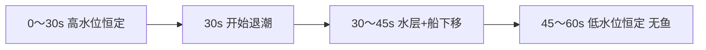

# 海底矿工 · 潮汐玩法 · Agent 策划简报

> **玩法一句话（V2 · 权威）**：**60 秒**宽关；**本局无涨潮过程**，开局即为 **高水位（满潮态）**；玩家操作 **浮在水面的渔船**（占位后换即梦）。**0～30s 水位不变** → **30～45s 一次退潮**（整层水+船下移）→ **45～60s 低水位不变**；鱼随 **Y 游动上限** 在退潮中渐没，**45s 全灭**；**打捞物钉在海床**不跟水层走。  
> **工程**：Godot 4 · `miner/` · 设计坐标 **1280×720**（宽关 `World1280` 横向滚动）。  
> **本文档**：正文 **§0～§5** 为 V2 首版实现依据；**附录 A** 为稀有潮种（不影响 V2 首版）。

---

## 0. 产品定位

| 项 | 约定 |
|----|------|
| 对外名称 | **海底矿工**（街机合集内独立小游戏） |
| 单局时长 | **60s**（`ROUND_TIME`） |
| 潮汐形态 | **无涨潮阶段**；起局已是 **最高水位**，仅 **一次退潮**（30～45s） |
| 玩家载体 | **渔船**浮在水面（替换现潜水艇占位）；**钩/绳**从船边入水 |
| 空间分层 | **水面活动带**（高度 = 原 **最上红线** `LAYER_SURFACE_Y≈176`）→ 其下 **海水+鱼群** → 再下 **沙滩/打捞物**（**世界坐标固定**） |
| 保留系统 | **订单**、**60s 计时**、**神秘箱**、**宽关滚动**、随机贝壳/宝石/珍珠与防重叠 |
| 背景 | **换版贴图**（渔船主题海床）；**V1 占位，后即梦替换** |
| 难度节奏 | **0～30s** 能钩底但 **鱼干扰大**；**30s 起退潮** 鱼渐少；**45s 后** 无鱼、轻松钩底 |

### 与「订单面板潮汐条」的关系

| 现状 | 目标 |
|------|------|
| 蓝色条绑定 **订单完成度** | 改为 **退潮进度/水位**；订单用 **数字/小条** |
| 无水面层 | **TideLayer**（视觉 + 鱼 + 船）；退潮时 **整层 Y 下移** |

---

## 1. 核心概念（V2 · 已定稿）

### 1.1 术语

| 阶段 | 时间 | 说明 |
|------|------|------|
| **高水位平台期** | 0～30s | `tide_layer_y` **恒定**；渔船 **仅横移** |
| **退潮期** | 30～45s | TideLayer **整体下移**（水+船+鱼） |
| **低水位平台期** | 45～60s | `tide_layer_y` **恒定**；**无鱼** |

### 1.2 场景节点（逻辑）

```text
World1280
├── Background（宽海床贴图，不随潮移动）
├── Collectibles（打捞物，钉在海床 Y，不随潮移动）
└── TideLayer（退潮时 position.y 增大 = 水面下沉）
    ├── WaterVisual（海面线、水体着色）
    ├── Fish…（游动边界随退潮更新）
    └── FishingBoat（随 TideLayer；0～30s 仅 X 轴 steer）
```

**已确认**：**打捞物不跟水层下移**，与背景海床同属 **固定世界坐标**。

### 1.3 一局时间轴（60s）



| 时段 | 水面 / 渔船 | 鱼群 | 钩底 |
|------|-------------|------|------|
| **0～30s** | 水位 **不变**（= 红线高度）；船 **只左右** | 正常 | **绳长够到底**；难在 **鱼碍事** |
| **30～45s** | **TideLayer 整体下移** | **Y 游动上限** 随水面 **逐步减员** | 干扰 **递减** |
| **45～60s** | **不再下降** | **45s 时已完全消失** | **轻松钩打捞物** |

- 退潮位移：`tide_layer_y = lerp(Y_HIGH, Y_LOW, smoothstep(30, 45, elapsed))`；**45s 后保持 Y_LOW**。
- **30s 前、45s 后** `tide_layer_y` **均不变**。
- 鱼清除：每条鱼 `swim_y_max` 绑定当前有效水面下缘；超出者 **出屏或 despawn**，**45s 数量为 0**。
- **全程**不因水位 **拒绝钩取** 海床打捞物（与旧稿「涨潮不可钩」不同）。

### 1.4 与现代码常量（实现时映射）

| 设计 | 现 `game.gd` 参考 |
|------|-------------------|
| 最高水面 / 船带 | `LAYER_SURFACE_Y`（176） |
| 鱼层 | `LAYER_FISH_Y_MIN`～`MAX`（186～388） |
| 打捞层 | `LAYER_SALVAGE_*`、`LAYER_DEEP_*` |
| 触沙 / 绳长 | 现 `claw.gd`；**高水位仍允许够到底** |

---

## 2. UI / 反馈

| 元素 | 说明 |
|------|------|
| **退潮进度条** | 复用/改版 `order_tide_bar.png`：**0～30s 满/静止**；**30～45s 从满到空**；**45～60s 空/低水态**。**无涨潮填充色** |
| **预告** | **30s** 一次 **「开始退潮」**（可选 2s）；**`icon_phase_ebb.png`**。**无「涨潮」文案/图标** |
| **订单区** | 文案保留；进度 **「3/5」** 或窄条，**不占退潮条** |
| **层级** | 预告 z_index 低于渔船操作反馈 |

---

## 3. 程序接口（V2 建议）

新建 `miner/scripts/miner_tide.gd`（或 `TideState`）：

```gdscript
enum Phase { HIGH_HOLD, EBBING, LOW_HOLD }

signal phase_changed(phase: Phase)
signal tide_layer_y_changed(y: float)

func advance(elapsed: float) -> void  # 与局内 elapsed 一致（0=开局）
func get_tide_layer_y() -> float
func get_phase() -> Phase
func get_fish_swim_y_max() -> float  # 鱼 Y 上限，退潮期收紧
func get_ebb_progress() -> float     # 0～1，供 UI 退潮条（30～45s 映射）
```

**挂接**：

- `game.gd`：`_process` 内 `TideState.advance(ROUND_TIME - time_left)`（或等价 elapsed）。
- 鱼：`configure_swim_bounds` 的 **Y 上限** 读 `get_fish_swim_y_max()`；45s 后不再生成/或清空剩余。
- **TideLayer** 根节点 `position.y = get_tide_layer_y()`；**Collectibles** 不在此节点下。
- `claw.gd`：**不**调用「水下不可钩」；保持现有抓取逻辑。

**V2 不包含**：正弦 `tide_level`、`roll_for_round` 多潮种、`can_hook_item` 拒抓、首版 `score_multiplier`（见附录热区）。

### 3.1 退潮动画与 WaterVisual（已实现占位）

| 项 | 约定 |
|----|------|
| 驱动量 | 标量 `tide_layer_y`（`MinerTideState`）；**非**改背景 UV |
| 动画 | `_process` + `smoothstep(30,45)` 赋 `TideLayer.position.y`；**不用** Tween 驱潮主逻辑 |
| 常量 | `Y_HIGH=0`，`Y_LOW≈150`（F5 微调与背景海面 ~235px 对齐） |
| WaterVisual | 单张 **`water_sky_tide_layer.png`（3072×1110，顶 150px 天空缓冲）** 或 fallback `water_layer.jpg`；`sprite.y = H/2 - tide_y` 滚入缓冲天空；底缘 shader 渐隐露 **`seabed_sand_layer`**；无 SkyCap/SkyGapFill |
| 鱼 | 挂 `FishContainer`；`get_fish_swim_y_max()` 收紧 `_max_y`；超出 despawn；**45s** `_purge_tide_fish` |
| UI | `miner_order_hud.set_ebb_bar_ratio` ← `ebb_bar_ratio`；**30s** `show_banner("开始退潮")` |
| 背景 shader | 首版保留 `sea_surface.gdshader` 弱波动；大位移由 TideLayer 负责 |

---

## 4. 贴图与美术资产清单

> **目录约定**：  
> - 预览 / 即梦源图 → `miner/assets/designs/tide/`  
> - 进游戏 → `miner/assets/tide/`、`miner/assets/ui/tide/`、`miner/assets/boat_placeholder.png` 等  
> - 工具 → `scripts/miner/prep_tide_*.py`（默认 preview，**`--game`** 写正式目录）

### 4.1 P0（V2 首版 · 占位优先）

| 文件名（建议） | 用途 | 规格提示 |
|----------------|------|----------|
| `boat_placeholder.png` | 渔船占位（或暂挂 `submarine.png` 仅改节点名） | 与现潜艇近似尺寸，**128～266px 宽** |
| `seabed_wide_boat.jpg` | 渔船主题 **宽海床** 背景 | 与现 `seabed_wide` 同长宽比；designs 先预览 |
| `tide/water_surface_strip.png` | 海面横条，**横 tile** | 高 **48～96px**，宽 **256/512** |
| `tide/water_gradient_overlay.png` | 海面下 **半透明蓝** 渐变 | 高 **200px** 宽 **64**；随 TideLayer |
| `ui/tide/tide_bar_frame.png` | 退潮条外框 | 基于 `order_tide_bar.png` 拆框；九宫格 |
| `ui/tide/tide_fill_ebb.png` | 退潮条填充 | 可 tile；**浅蓝/泡沫白** |
| `ui/tide/icon_phase_ebb.png` | **开始退潮** 预告图标 | **64×64** |

### 4.2 P1（V2  polish）

| 文件名 | 用途 |
|--------|------|
| `tide/shore_foam_cap.png` | 退潮露沙 **湿痕/泡沫** 横 tile |
| `audio/tide_fall_loop.ogg` | 退潮环境 loop |
| `audio/tide_ebb_sting.ogg` | 30s **开始退潮** 短 sting |

### 4.3 即梦 Prompt 参考（预览）

**宽关背景（与进游戏 `seabed_wide.jpg` 同尺寸）**

| 项 | 值 |
|----|-----|
| 像素 | **3072 × 960**（宽 × 高，与现 `miner/assets/seabed_wide.jpg` 一致） |
| 比例 | 3.2 : 1 |
| 分层（高约） | 上 **0～235px** 天空+海面线；**235～530px** 纯水（**无鱼**）；**530～960px** 沙滩海床 |

**即梦主提示词（中文）**

```text
2D横版游戏背景，精确尺寸3072像素宽960像素高，超宽长图，侧视，可爱卡通手绘，明亮柔和，街机休闲风格。
画面上方约四分之一：浅蓝色天空，阳光从左上角照入，画面在垂直方向约235像素高度处有一条清晰水平的海面，白色泡沫和轻微波浪反光。
海面以下到约画面中部：清澈蓝色海水，水下体积光和气泡，远处可有一两条极模糊的沉船或礁石剪影，水中不要出现任何鱼、不要出现潜水员。
画面下方约一半：浅黄色海底沙滩，细腻沙纹ripple，零星绿色海草和小珊瑚、小石块，沙面留出大面积空白不要画金币宝箱，不要画人物和船只。
无潜艇，无渔船，无钩爪，无文字，无logo，无水印，左右构图连续适合横向滚动。
```

**不希望出现（有则填入）**

```text
鱼，热带鱼，鱼群，潜艇，潜水艇，渔船，人物，金币，宝箱，文字，水印，logo，写实照片，3D，竖图
```

| 其它资产 | Prompt 要点 |
|----------|-------------|
| 渔船 | 2D 卡通小渔船，侧面，绿幕/白底，可爱，无文字 |
| 海面横条 | 横版海水表面泡沫横条，绿幕或白底，无文字 |
| 退潮 UI 框 | 竖长条进度槽空框，金色镶边，可爱 UI，白底 |

### 4.4 Shader（可减贴图）

| 效果 | 方案 |
|------|------|
| 水体 | 扩展 `sea_surface.gdshader` 或 TideLayer 下 **ColorRect/渐变** 随 `tide_layer_y` |
| 露沙 | 背景固定；退潮为 **水层下移** 露出已有沙床美术 |

---

## 5. 实现分期与 QA

### 5.1 分期

| 阶段 | 内容 | 验收 |
|------|------|------|
| **P0** | TideLayer + 时间轴；渔船占位；海面条/渐变；退潮条 UI；30s 预告；鱼 Y 上限 | 见 **5.2** |
| **P1** | 新背景进游戏；退潮音；沙边泡沫；订单与退潮条 **完全分离** | 听感+视觉 polish |
| **P2** | 附录 **稀有潮种**（按需） | 不影响 V2 基线 |

### 5.2 QA 清单

- [ ] **0～30s**：TideLayer **Y 不变**；渔船 **仅横移**；鱼正常；**可钩底**
- [ ] **30～45s**：TideLayer **平滑下移**；**退潮时** 鱼 **Y 上限** 下降、数量渐少
- [ ] **45～60s**：Y **不变**；**无鱼**；钩底 **无鱼干扰**
- [ ] **打捞物 Y** 不随潮变化；宽关 **横向滚动** 正常
- [ ] 订单、神秘箱、**60s 计时** 无冲突
- [ ] 文档与实现 **无涨潮阶段**、**无「涨潮不可钩」**

---

## 附录 A · 后续扩展（稀有潮种 · 非 V2 首版）

> 以下 **不改变** §1.3 时间轴基线，除非单独立项。实现前需与产品 **单独排期**。

### A.1 潮种 Roll（概念）

| 潮种 id | 名称 | 触发率（建议） | 说明 |
|---------|------|----------------|------|
| `BASELINE` | V2 基线 | 默认 | 即 **§1.3**（无涨潮、一次退潮） |
| `EBB_PLUS` | 退潮强化 | ~15% | 45s 低水位后 **+2～3** 个底层 bonus 物（防重叠） |
| `BLOOD_MOON` | 血月潮 | ~4% | **30s 起替换退潮**：水位保持高水位到 60s；冲走低价值，留下并补入高价值 |
| `HOT_ZONE` | 热区 | ~4% | 沙床 **X 段** 高亮 10～14s；区内得分 **×1.35**（cap **×1.5**） |
| `BLOOD_HOT` | 血月+热区 | ~1% | 组合；互斥 roll |

**不含**：`FLOOD` / **涨潮强化** / 正弦多周期（与 V2 冲突，**废弃**）。

### A.2 规则摘要

**血月 `BLOOD_MOON`**

- **30s 不退潮**，高水位保持到 60s，45s **不清鱼**。
- 冲走低价值（石头、金币、井、罐、桶、贝壳等）；留下钱堆、宝石、珍珠、金块、宝箱、神秘箱；并冲入 3～5 件高价值。
- **完整规则 + 美术规格 + 豆包 prompt** → [海底矿工_血月潮_Agent策划简报.md](海底矿工_血月潮_Agent策划简报.md)

**热区 `HOT_ZONE`**

- 随机 `[hot_x0, hot_x1]`，Y 覆盖 salvage/deep 带；**Mystery** 不计倍率。
- 场景 **金圈/矩形** + 可选右侧 **8s 倒计时**。

### A.3 扩展资产（P2 / 附录）

| 文件名 | 用途 |
|--------|------|
| `ui/tide/icon_rare_blood_moon.png` | 血月图标 64×64 |
| `ui/tide/icon_rare_hot_zone.png` | 热区图标 |
| `ui/tide/banner_blood_moon.png` / `banner_hot_zone.png` | 稀有横幅 |
| （不做 `water_surface_strip_red`） | 血月海面改由水层 shader 染色，不另画条 |
| `tide/moon_blood.png` | 血月月盘 |
| `tide/hot_zone_ground.png` | 沙床金圈 |
| `tide/hot_zone_edge_spark.png` | 热区边缘 4 帧 |
| `tide/fish_blood_01.png` | 血月鱼（或 fish 染色 shader） |
| `tide/blood_moon/clouds_blood.png` | 月旁完整红云（非雾带） |
| `audio/tide_rare_blood_sting.ogg` | 血月 sting |
| `audio/tide_rare_hot_sting.ogg` | 热区 sting |

### A.4 扩展接口（预留）

```gdscript
func roll_rare_modifier(seed: int) -> StringName  # 附录用
func score_multiplier_for_item(item: Collectible) -> float  # 热区/血月
```

---

## 6. 变更记录

| 日期 | 说明 |
|------|------|
| 2026-10-05 | 初稿：多周期涨退、五种潮种、资产清单 |
| 2026-10-05 | V2 对齐：渔船；0～30 恒定 / 30～45 退潮 / 45～60 恒定；鱼渐没；打捞物钉海床 |
| 2026-10-05 | **文档修订**：剔除 **涨潮阶段**；正文仅 **一次退潮**；删不可钩底/正弦/FLOOD；稀有潮种移 **附录 A** |
| 2026-10-05 | **退潮动画落地**：`miner_tide.gd`、`TideLayer`+`WaterVisual`+`FishContainer`；UI 退潮条与 30s 预告；§3.1 |
| 2026-10-05 | **水面视觉**：去掉 WaterVisual 占位蓝带/白线；退潮仅 TideLayer 下移 + 背景露沙 |
| 2026-10-07 | 附录 A.2 增加 [血月潮独立策划简报](海底矿工_血月潮_Agent策划简报.md) 链接 |
| 2026-10-07 | 附录 A：血月改为 30s 替换退潮的高收益冲刷，不再使用短窗鱼惩罚 |
