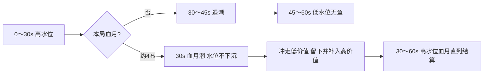

# 海底矿工 · 血月潮 · Agent 策划简报

> **定位**：V2 **稀有潮种** `BLOOD_MOON`。开局 Roll 中后，**elapsed = 30s** 时 **不进入退潮**，水位停在高水位，直接进入 **血月潮**，直到 60s 结算。  
> **母文档**：[海底矿工_潮汐玩法_Agent策划简报.md](海底矿工_潮汐玩法_Agent策划简报.md) §1.3 仍是 **未中血月** 的基线（30～45s 退潮 → 45～60s 低水位）。血月局 **替换** 这条后半段，不改 0～30s。  
> **工程**：Godot 4 · `miner/` · 设计坐标 **1280×720**；沙层固定 + 水层 `TideLayer`。

---

## 0. 体验一句话

约 **4%** 的局，前 30 秒与普通局相同。**第 30 秒**天空与海面转成暗红血月，水面 **不下沉**。一股红潮把沙上的 **低价值物冲出屏幕**，**宝石、珍珠、宝箱等高价值留下**，并 **从潮向再冲进几件高价值**。后 30 秒是高水位、鱼还在、但海底明显更「富」的捞取窗口。

---

## 1. 与 V2 基线的分叉

| 时段 | 普通局 | 血月局 |
|------|--------|--------|
| **0～30s** | 高水位恒定 | **相同** |
| **30s** | 预告「开始退潮」 | 预告 **「血月潮」**；**跳过退潮** |
| **30～60s** | 30～45s 水层下移；45s 清鱼；45～60s 低水位无鱼 | **水位保持高水位**；鱼 **不在 45s 清场**；沙床完成一次冲刷后保持到结算 |



**不变**：60s 计时、订单、宽关横向滚动、0～30s 船只横移、打捞物在冲刷前钉在海床（不跟水层走）。

---

## 2. 规则

### 2.1 触发

| 项 | 值 |
|----|-----|
| 潮种 id | `BLOOD_MOON` |
| 触发 | 开局与 `EBB_PLUS`、`HOT_ZONE` **互斥 roll**，约 **4%** |
| 种子 | 绑定局种子，可复现 |
| 切入点 | **elapsed = 30.0s**，无随机提前/延后 |
| 持续 | **30～60s**（剩余整段，不是 12～15s 短窗） |
| 水位 | `tide_layer_y` **停在高水位**，**不** lerp 到 `Y_LOW` |
| 鱼 | **不执行** 45s 清鱼；游动上限保持高水位 |

### 2.2 价值分档（按现 `collectible.gd`）

冲刷只处理 **还在沙上、未被钩住** 的打捞物。正在回收的那一件 **不参与**。

| 档 | 种类 | 现价值 | 30s 血月 |
|----|------|--------|----------|
| **低价值 · 冲走** | 石头、金币、水井、瓦罐、木桶、贝壳 | 20～120 | 沿潮向滑出屏幕后移除 |
| **高价值 · 留下** | 钱堆、宝石、珍珠、金块、宝箱 | 180～500 | 留在原位，短闪光 |
| **特殊 · 留下** | 神秘箱 | 0（事件物） | **不按价值冲走** |
| **鱼** | 鱼层 | — | **不参与沙床冲刷**；血月期继续游 |

**订单保护**（避免潮汐作废订单）：

| 本局订单 | 额外不冲走 |
|----------|------------|
| 淘金（5 个金币或钱堆） | **金币**（钱堆本来就留下） |
| 三种鲜鱼 / 避开顽石 | 无。石头、木桶照常冲走，对「避开顽石」是减负 |

### 2.3 冲入的高价值

冲刷结算的同一段里，从 **潮来方向屏外** 滑入 **4** 件（允许 3～5），落在沙床空位，防重叠，落定后可钩。

| 种类 | 权重 | 上限 |
|------|------|------|
| 宝石 | 40 | — |
| 珍珠 | 30 | — |
| 金块 | 20 | — |
| 宝箱 | 10 | **每局最多 1** |

不补低价值，不补神秘箱，不补鱼。  
**分数不加乘**。高收益来自「垃圾被冲走 + 高价值变多」，不与热区叠 ×1.15。旧稿的撞钩惩罚、血月鱼干扰 **取消**。

### 2.4 冲刷演出（约 3s）

| 时间（自 30s） | 发生什么 |
|----------------|----------|
| 0～0.6s | 横幅「血月潮」+ sting；月盘、雾、水面转红开始淡入；潮向确定（本局左→右或右→左，二选一） |
| 0.6～2.4s | 低价值沿潮向加速滑出；高价值原地闪光；新高价值从入潮侧滑到空位 |
| 2.4～60s | 红月视觉保持到结算；沙床不再二次冲刷；水位仍为高水位 |

滑出中的物体 **不可钩**。滑入物体在 **落定后** 可钩。

### 2.5 UI

| 时机 | 内容 |
|------|------|
| 30s | **「血月潮」** 横幅约 2s + `icon_rare_blood_moon.png`；**不播**「开始退潮」 |
| 退潮条 | 血月局 **保持满水 / 高水态**，不要走「满→空」。可用红色染色区分 |
| 订单区 | 在全屏 tint 之上，文案逻辑不变 |

---

## 3. 要不要重新制作美术

**现有沙层、水层长图不用重画，也不要换成一整张血月海。**  
血月时 `TideLayer` 停在高水位，继续用现在的 `seabed_sand_layer` 与 `water_sky_tide_layer`。红月靠 **叠加**，不靠替换 3072 长图。

**要新画的是血月专用叠加件**（上一版简报里的鱼惩罚图可以不做）。这些还没进游戏，按本节出 **预览**，用户说「进游戏」后再写入正式目录。

| 要不要画 | 内容 | 原因 |
|----------|------|------|
| **不用** | 整张血月水层 / 血月沙层 | 高水位长图已经能用；整图替换成本高，退潮局还要切回蓝海 |
| **不用** | 每种打捞物的血月版 | 冲走、留下、冲入都用 **现有贴图 + 位移 / 闪光** |
| **不用（首版）** | 血月鱼、撞钩惩罚特效 | 本版玩法已取消 |
| **要画** | 月盘、月旁红云、横幅、图标 | 30s 一眼能认出「不是退潮」 |
| **不画** | 红海面条 | 现有水层是一整张画，泡沫线对不齐；海面变红改由 shader 只染海面以下 |
| **可后做** | 雾动画、月晕、环境 loop | 不挡 BM-P0 |

### 3.1 色彩与层级

卡通街机，偏亮紫红，不做成写实 horror。全屏 multiply 建议 `#8a2848`、alpha **0.22～0.32**。订单与分数在 tint 之上。

```text
World1280
├── Background（现有沙层，不替换）
├── Collectibles（冲刷只改这里的成员与 X 动画）
├── TideLayer（血月期 Y 保持高水位）
│   ├── WaterVisual（现有水层；血月时 shader 只染海面以下）
│   ├── FishContainer（继续游，不清场）
│   └── Submarine / 渔船
├── BloodMoonFx（月盘、雾；跟 TideLayer 的竖直位置，宽关横滚一起走）
└── BloodMoonTint（全屏，不随横滚重复铺月盘）

HUD — tint 之上
```

---

## 4. 资产清单

预览：`miner/assets/designs/tide/blood_moon/`  
进游戏：`miner/assets/tide/blood_moon/`、`miner/assets/ui/tide/`、`miner/assets/audio/`  
用户确认 **「进游戏」** 后再 `--game`。

### 4.1 首版要画

| 文件名 | 规格 | 用途 |
|--------|------|------|
| `ui/tide/icon_rare_blood_moon.png` | 64×64 透明 | 图标 |
| `ui/tide/banner_blood_moon.png` | 约 520×96 透明 | 横幅底，中央留空给「血月潮」 |
| `tide/blood_moon/moon_blood.png` | 320×320 透明 | 月盘 |
| `tide/blood_moon/clouds_blood.png` | 1024×512 透明 | 三四朵完整红云，摆在月盘旁边，不做成左右切断的雾带 |
| （不做） | — | 不另画红海面条。`water_layer.gdshader` 用 `blood` 0～1，只对世界坐标低于海面的像素乘浅红 |
| `audio/tide_rare_blood_sting.ogg` | 0.6～1.2s | 30s sting |

### 4.2 程序即可，不必出图

低价值滑出、高价值闪光、新物品滑入、全屏 tint、退潮条改红色满水态。缺月盘/雾时，**仅 tint + 横幅** 也必须能玩完冲刷。

### 4.3 明确不做

`fish_blood_01.png`、撞钩 debuff 图标、3072×1920 血月水长图、单独血月沙层。

---

## 5. 豆包 / 即梦 Prompt

### 5.1 月盘 `moon_blood.png`

```text
2D卡通游戏UI元素，一轮血月，圆形，精确尺寸320像素乘320像素，透明背景PNG。
可爱街机风格，非写实，非恐怖；月亮表面浅红与暗紫红环形阴影，边缘柔和粉红色外发光，少量卡通陨石坑。
不要文字，不要水印，不要3D，不要血滴飞溅，不要骷髅。
```

### 5.2 月旁红云 `clouds_blood.png`

不用横向雾带。血月旁放几朵完整红云，左右不被画面切断。

```text
2D卡通游戏贴图，精确尺寸1024像素宽、512像素高，透明背景PNG。
画面里放3到4朵彼此分开的完整红云，每一朵都完整，上下左右都不要被画面边缘切断。
云的颜色对齐血月：云顶浅粉，云身珊瑚红，云底暗紫红，带柔和卡通描边，可爱街机风格，非写实。
云与云之间留出透明空隙，方便以后单独摆到月亮左上和右上。
不要画月亮，不要星星，不要海水，不要沙滩，不要文字，不要水印，不要左右拼接，不要只露出半朵云。
```

### 5.3 海面变红（不做新图）

现有 `water_sky_tide_layer` 的泡沫线是画死在长图里的。再叠一条 512×64 红泡沫会对不齐浪形，宽关横铺还会重复。血月时只把水层 sprite 的 shader 从 `blood = 0` 淡到 `1`，海面以上的天空像素不染，船、鱼、沙不在这张 sprite 上，不会一起变红。

### 5.4 横幅 `banner_blood_moon.png`

```text
2D游戏UI横幅底图，520像素宽96像素高，透明PNG。
深紫红到黑色渐变长条，金色细描边，中央留空给文字，可爱卡通UI。
不要任何文字，不要水印。
```

### 5.5 图标 `icon_rare_blood_moon.png`

```text
2D游戏图标64像素乘64像素，透明PNG，简化小血月，紫红与粉红，清晰可读，卡通。
不要文字，不要水印。
```

---

## 6. 程序挂接

| 模块 | 说明 |
|------|------|
| Roll | 开局 `BLOOD_MOON` 或基线；30s 前水位逻辑与基线相同 |
| 30s 分支 | 血月：`phase` 进入血月而不是 `EBBING`；`get_tide_layer_y()` 保持高水位；`get_ebb_progress()` 保持 0（条保持满） |
| 清鱼 | 血月局 **跳过** 45s despawn |
| 冲刷 | 一次扫描 Collectibles：低价值滑出销毁；高价值与神秘箱留；按 §2.3 生成并滑入 |
| 订单 | §2.2 淘金局保留金币 |
| 缺图 | tint + 横幅 + 位移，玩法完整 |

---

## 7. QA

- [ ] 非血月局：30s 仍退潮，45s 无鱼，无红 tint 残留  
- [ ] 血月局：30s **没有**水层下移，45s **仍有鱼**，60s 前水位与 0～30s 同高  
- [ ] 30s 后沙上石头/散金币/井/罐/桶/贝壳消失（淘金订单时金币仍在）  
- [ ] 钱堆、宝石、珍珠、金块、宝箱、神秘箱留在原位  
- [ ] 新滑入 3～5 件，且只有宝石/珍珠/金块/宝箱，宝箱 ≤1，不重叠  
- [ ] 滑出过程钩不中；落定后能钩到新物品  
- [ ] 横幅是「血月潮」，不是「开始退潮」；HUD 可读  
- [ ] 正在回收的物品不被冲走  

---

## 8. 分期

| 阶段 | 内容 |
|------|------|
| **BM-P0** | Roll、30s 跳过退潮、水位与鱼保持、冲刷规则、横幅、tint |
| **BM-P1** | 月盘、月旁红云、水层 shader 染海面、sting、退潮条血月染色 |
| **BM-P2** | 雾动画、环境 loop |

---

## 9. 变更记录

| 日期 | 说明 |
|------|------|
| 2026-10-07 | 初稿：短窗 tint、血月鱼、撞钩惩罚、GEM/PEARL ×1.15 |
| 2026-10-07 | **重写**：30s 替换退潮；高水位保持到 60s；冲走低价值、留下并补入高价值；长图不重画 |
| 2026-10-07 | 红雾条改为月旁完整红云，不再做 1024×128 横拼雾带 |
| 2026-10-07 | 取消红海面条；海面变红改为水层 shader 只染海面以下 |

---

## 10. 给 Agent 的开场指令（可复制）

```text
请阅读 docs/海底矿工_血月潮_Agent策划简报.md 与 docs/海底矿工_潮汐玩法_Agent策划简报.md §1.3。
血月潮：开局约 4% roll。仅血月局在 elapsed=30s 跳过退潮，TideLayer 保持高水位直到 60s，45s 不清鱼。
30s 一次冲刷：冲走石头/金币/井/罐/桶/贝壳（淘金订单时保留金币）；留下钱堆、宝石、珍珠、金块、宝箱、神秘箱；再滑入 3～5 件宝石/珍珠/金块/宝箱（宝箱最多 1）。
不要做血月鱼惩罚，不要分数 ×1.15，不要替换沙层/水层长图。
美术只出 designs/tide/blood_moon/ 预览，用户说进游戏后再写入正式资源。
```
